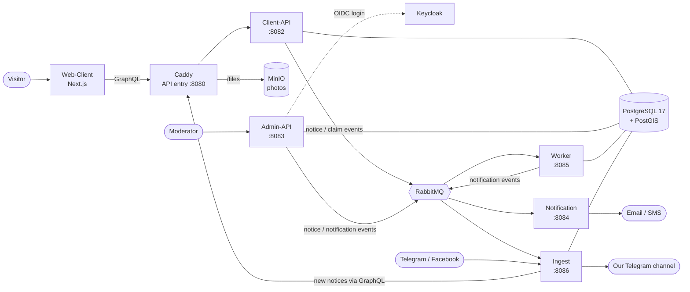

<div align="center">

# DeRechi

**Lost something? Found something? DeRechi brings the two together.**

A lost-and-found service: people post what they lost or found, the system matches the two kinds
of notice in the background, and the owner hears about a likely match by email or SMS.

[derechi.site](https://derechi.site) · [Documentation](__docs/README.md) · [Getting started](__docs/developer-guide/getting-started.md) · [Architecture](__docs/architecture/README.md)


</div>

---

## What it does

- **Lost and found notices** with a photo, a place on the map, a reward in the local currency
  and contacts that stay masked on the public site.
- **Automatic matching.** Every new notice is compared against the opposite kind: same category,
  within three days and 20 km, ranked by full-text similarity. The top five candidates are kept
  for moderators.
- **"It's mine" / "I found it" claims.** A visitor leaves their contacts on a notice and the
  author gets them by email and SMS. Both sides are asked to confirm the return, and unconfirmed
  notices are archived automatically.
- **Admin panel** for moderators: matches, notices, archives and one-click "Notify the owner",
  with fine-grained permissions on top of Keycloak roles.
- **SEO-first public site**: server-rendered Next.js with per-city pages and structured data.

## How it fits together



All services share one PostgreSQL database whose schema is owned by a single module
(`DB-Postgres`), and talk to each other only through RabbitMQ. The longer tour with both main
flows step by step is in [Architecture](__docs/architecture/README.md).

## Modules

| Module | Port | Role |
|---|---|---|
| [`Web-Client`](Web-Client/README.md) | 3000 | Public site. Next.js App Router, Tailwind, shadcn/ui. Built with pnpm, outside the Maven reactor |
| [`Client-API`](__docs/architecture/modules/client-api.md) | 8082 | Public GraphQL API for the site |
| [`Admin-API`](__docs/architecture/modules/admin-api.md) | 8083 | Admin panel: Spring MVC, Thymeleaf and htmx under `/admin/**` |
| [`Worker`](__docs/architecture/modules/worker.md) | 8085 | Matching, claims, reminders, automatic archiving, scheduled jobs |
| [`Notification`](__docs/architecture/modules/notification.md) | 8084 | Email and SMS through NotifyHub |
| [`Ingest`](__docs/architecture/modules/ingest.md) | 8086 | Import from Telegram and Facebook, posting to our channel. Exactly one replica |
| [`DB-Postgres`](DB-Postgres/README.md) | | Entities and Liquibase migrations. Applies them and exits |
| [`Getaway`](__docs/architecture/modules/getaway.md) | 8080 | Spring Cloud Gateway. Disabled for now: Caddy holds 8080 |

Every Spring service exposes Actuator on its management port, the service port + 1000.

## Tech stack

| Layer | What we use |
|---|---|
| Backend | Java 26 with virtual threads, Spring Boot 4.1, Spring for GraphQL, Spring Data JPA, Hibernate Spatial |
| Frontend | Next.js 16, React 19, next-intl, Tailwind CSS 4, shadcn/ui |
| Data | PostgreSQL 17 + PostGIS, Ukrainian and Polish full-text dictionaries, Liquibase |
| Messaging | RabbitMQ 4.3 with quorum queues and a dead-letter queue per consumer |
| Identity and files | Keycloak 26, MinIO (S3) |
| Edge | Caddy 2.11 |
| Observability | Prometheus, Alertmanager, Grafana |
| Ingest | TDLib (TDLight), OpenRouter, Tesseract OCR, ONNX face detection |

Exact versions and the reasons behind each choice: [tech-stack.md](__docs/architecture/tech-stack.md).

## Quick start

You need **JDK 26** and **Docker** (give it at least 4 GB). Maven comes with the wrapper; pnpm is
only needed for the web client.

```bash
git clone https://github.com/Shpytchuk-Vasyl/DeRechi.git
cd DeRechi

# 1. Infrastructure: PostgreSQL, RabbitMQ, Keycloak, MinIO, Caddy, Mailpit, pgAdmin, monitoring
docker compose --profile dev up -d

# 2. Schema
./mvnw -pl DB-Postgres liquibase:update

# 3. Services (or run the *Application classes from IntelliJ IDEA)
./mvnw -pl Client-API spring-boot:run
./mvnw -pl Admin-API spring-boot:run
./mvnw -pl Worker spring-boot:run
./mvnw -pl Notification spring-boot:run

# 4. Web client
cd Web-Client && pnpm install && pnpm dev
```

Or everything in containers with one command:

```bash
docker compose --profile dev -f docker-compose.yml -f docker-compose.services.yml up -d --build
```

> [!IMPORTANT]
> The committed `docker-compose.yml` is production-safe and imports no Keycloak users. Before the
> first start, uncomment the dev users' volume line locally (marked `# only for development`) and
> don't commit it. See [Keycloak dev users](__docs/deployment/keycloak.md#dev-users).

> [!TIP]
> If your machine's time zone is `Europe/Kiev`, set `MAVEN_OPTS=-Duser.timezone=Europe/Kyiv`.
> PostgreSQL rejects the old spelling and every connection fails otherwise.

The full walkthrough, from an empty machine to a matched pair of notices and an email in the
mailbox, is in [Getting started](__docs/developer-guide/getting-started.md).

### Local URLs

| What | URL | Login |
|---|---|---|
| Public site | http://localhost:3000 | |
| Admin panel | http://localhost:8083/admin | `admin@derechi.local` / `admin` |
| GraphiQL | http://localhost:8080/graphiql | |
| Keycloak | http://localhost:8180 | `admin` / `admin` |
| RabbitMQ | http://localhost:15672 | `derechi` / `derechi` |
| Mailpit | http://localhost:8025 | |
| MinIO console | http://localhost:9001 | `derechi` / `derechi123` |
| Grafana | http://localhost:3000 | `admin` / `admin` |

Grafana and the web client both default to port 3000; run one of them on another port if you need
both. The rest of the ports are in [Local development](__docs/deployment/local-development.md).

## Tests

```bash
./mvnw test                    # unit and Testcontainers tests across the reactor
tests/run.sh --profile smoke   # quick run of the cross-service stack tests
cd Web-Client && pnpm test     # Vitest; Playwright end-to-end tests live in Web-Client/e2e
```

More in [Testing locally](__docs/developer-guide/testing-locally.md) and
[Stack tests](__docs/developer-guide/stack-tests.md).

## Repository layout

```
.
├── Admin-API/  Client-API/  Worker/  Notification/  Ingest/   Spring Boot services
├── DB-Postgres/          entities and Liquibase changelog (the only owner of the schema)
├── Getaway/              Spring Cloud Gateway, disabled for now
├── Web-Client/           Next.js public site (pnpm, outside the reactor)
├── docker/               configs for Postgres, Keycloak, RabbitMQ, Caddy, Prometheus, Grafana
├── tests/                cross-service integration, k6 load and redaction tests
├── __docs/               all project documentation
├── docker-compose.yml            infrastructure
├── docker-compose.services.yml   the services as containers
├── docker-bake.hcl  Dockerfile   image builds
└── env.local  env.prod  env.test environment files
```

## Documentation

Everything lives in [`__docs/`](__docs/README.md):

| Section | Inside |
|---|---|
| [Architecture](__docs/architecture/README.md) | Modules, database, messaging, authentication, storage, observability |
| [Features](__docs/features/README.md) | What the product does today, feature by feature |
| [Conventions](__docs/conventions/README.md) | Code style, configuration, migrations, i18n, logging, tests, Git |
| [Deployment](__docs/deployment/README.md) | Compose, images, environment variables, Keycloak, monitoring |
| [Extending](__docs/extending/README.md) | Checklists: a new language, country, category, permission, event, module |
| [Developer guide](__docs/developer-guide/README.md) | From ticket to production, troubleshooting |
| [Processes](__docs/processes/README.md) | Code review, database changes, releases, definition of done |

## License

Proprietary. All rights reserved. See [LICENSE](LICENSE).
